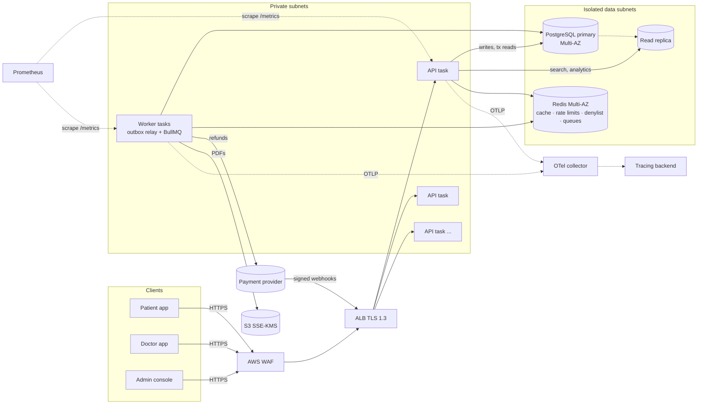
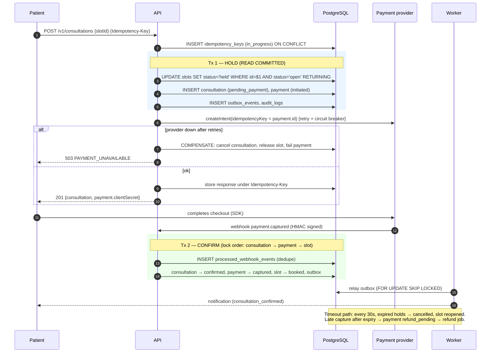

# Amrutam Telemedicine Backend — Architecture

## 1. Goals and constraints

| Requirement   | Target                                                                          | How it is met (summary)                                                                                      |
| ------------- | ------------------------------------------------------------------------------- | ------------------------------------------------------------------------------------------------------------ |
| Scale         | 100k consultations/day (~1.2/s average, ~15/s at a 10x peak; reads ~50x writes) | Stateless API on autoscaled Fargate, read replica for search and analytics, Redis cache                      |
| Latency       | p95 < 200 ms reads, < 500 ms writes                                             | Index-only access paths, keyset pagination, cache-aside, no network calls inside DB transactions             |
| Availability  | 99.95% (≈ 22 min/month)                                                         | 3 AZs, Multi-AZ RDS and Redis, rolling deploys with auto-rollback, graceful drain                            |
| Security      | Encryption, MFA, RBAC                                                           | TLS 1.2+, KMS at rest, AES-256-GCM on PHI columns, TOTP MFA for privileged roles, RBAC with ownership checks |
| Observability | Metrics, logs, traces                                                           | Prometheus RED/business metrics, pino JSON logs with trace correlation, OpenTelemetry traces                 |

This is a **modular monolith**: one codebase, one deployable, with modules split by business area (`auth`, `doctors`, `availability`, `consultations`, `payments`, `prescriptions`, `admin`, `audit`). Each module has its own repository → service → routes layers, and they are wired together with constructor dependency injection (awilix, `src/container.ts`). At 100k consultations a day, microservices would add network hops, distributed transactions and ops cost without adding headroom. Because the module boundaries are explicit, payments or notifications can be extracted later behind the existing ports (`PaymentGateway`, `NotificationSender`, `DocumentStorage`) without changing the domain code.

## 2. High-level architecture and data flow



**How a request flows.** Every request gets a request id (taken from `X-Request-Id` if valid, otherwise generated) and an `AsyncLocalStorage` context. The pipeline then runs RED metrics, structured logging, helmet and CORS, then JSON parsing, which also keeps the raw bytes for webhook HMAC checks. Next come the global per-IP rate limit, authentication (JWT plus a Redis denylist), route-level RBAC, an MFA gate, per-route rate limits, idempotency for unsafe writes, zod validation, the service call, and finally a single error envelope.

**Writes vs. reads.** Writes and read-your-own-write reads go to the primary. Doctor search, slot listing and analytics are lag-tolerant, so they go to the replica and are cached briefly in Redis.

**Side effects.** Side effects (notifications, refunds, PDF rendering) are never run inline. The service writes an **outbox event** in the same transaction as the state change; the worker relays it to BullMQ and processes it with retries.

## 3. Booking flow (saga)



How the booking rules are guaranteed:

- **No double booking.** The hold is a single conditional `UPDATE` (compare-and-set). Under READ COMMITTED, a competing transaction waits on the row lock, re-checks the `WHERE` clause against the committed row, matches zero rows, and gets `409`. As a second guard, a partial unique index on `consultations(slot_id)` covers live statuses. A test fires 10 parallel bookings at one slot and asserts exactly one succeeds.
- **No overlapping availability.** A `btree_gist` exclusion constraint on `(doctor_id, tstzrange(start,end))` rejects overlaps.
- **Idempotent writes.**
  - Booking, cancel, prescription and payment-confirm calls require `Idempotency-Key`. Keys are scoped per user, store a hash of the request, keep the response for 24 hours, and use a lock that expires so a crashed request can be taken over.
  - The response is saved _before_ it is sent, so an immediate retry always gets the replay.
  - Provider calls reuse the payment id as their idempotency key, and webhooks are deduplicated by event id.
- **No deadlocks.** All three writers (webhook, cancel and expiry) lock rows in the same order: consultation → payment → slot. The expiry job uses `SKIP LOCKED`, and the transaction helper retries `40001`/`40P01` with jitter.

## 4. Data model (ER)

```mermaid
erDiagram
  users ||--|| profiles : has
  users ||--o| doctors : "is (role=doctor)"
  users ||--o{ refresh_tokens : "sessions"
  doctors ||--o{ availability_slots : publishes
  availability_slots ||--o{ consultations : "booked as (≤1 live)"
  users ||--o{ consultations : "patient of"
  doctors ||--o{ consultations : "conducts"
  consultations ||--o| prescriptions : yields
  consultations ||--o{ payments : "paid by"
  users ||--o{ audit_logs : "actor of"
  users { uuid id PK; citext email UK; text password_hash; user_role role; bool mfa_enabled; text mfa_secret_enc; int failed_login_attempts; timestamptz locked_until }
  profiles { uuid user_id PK,FK; text full_name; text phone_enc; date date_of_birth; citext city }
  doctors { uuid user_id PK,FK; text registration_number UK; text[] specializations; text[] languages; int consultation_fee_paise; numeric rating; bool is_verified; tsvector search_vector }
  availability_slots { uuid id PK; uuid doctor_id FK; timestamptz start_at; timestamptz end_at; slot_status status; int version }
  consultations { uuid id PK; uuid patient_id FK; uuid doctor_id FK; uuid slot_id FK; consultation_status status; timestamptz scheduled_start; text reason_enc; text doctor_notes_enc; int version }
  prescriptions { uuid id PK; uuid consultation_id UK,FK; text diagnosis_enc; text medications_enc; text document_status }
  payments { uuid id PK; uuid consultation_id FK; int amount_paise; payment_status status; text provider_payment_id UK }
  audit_logs { uuid id PK; timestamptz occurred_at PK; uuid actor_id; text action; text entity_type; text entity_id; jsonb metadata; text signature }
```

Supporting tables: `idempotency_keys`, `outbox_events`, `processed_webhook_events`, and the `consultation_daily_stats` materialized view. Full DDL is in `migrations/`. Money is stored as integer paise and all times as `timestamptz` (UTC). Each consultation has an explicit state machine (`consultation-state.ts`), and every status change is a conditional `UPDATE … WHERE status = ANY(sources)`.

## 5. API schema

The API is REST, documented in `openapi/openapi.yaml` (OpenAPI 3.1), served at `/openapi.json` and explorable at `/docs` outside production. REST was chosen over GraphQL for four reasons: HTTP-native idempotency keys and caching, per-route rate limits and RBAC, the access patterns are simple and known in advance, and webhooks are REST anyway. Other conventions:

- **Versioning:** URI versioning (`/v1`).
- **Pagination:** cursor based.
- **Errors:** one envelope, `{error:{code,message,details,requestId}}`.
- **Hiding resources:** a `404` is returned for resources the caller may not see, so their existence is not revealed.

## 6. Retry and backoff strategy

| Where            | Policy                                                                                                                              | Why                                                                           |
| ---------------- | ----------------------------------------------------------------------------------------------------------------------------------- | ----------------------------------------------------------------------------- |
| DB transactions  | Up to 3 retries on serialization failure or deadlock, full jitter 20–250 ms                                                         | Transient by definition; safe because the whole transaction re-runs           |
| Payment provider | Up to 3 retries on retryable errors only (timeouts, 5xx, 429), full jitter 100 ms–2 s; circuit breaker (5 failures → open for 30 s) | Declines must not retry; a breaker stops piling timeouts onto request threads |
| Background jobs  | BullMQ, 6 attempts, exponential 2 s → 64 s; exhausted jobs stay in the failed set (DLQ) and are alerted on                          | Absorbs provider outages of minutes without losing work                       |
| Outbox relay     | Loop with 0.5 s idle sleep, 2 s backoff on error; delivery is at-least-once and consumers are idempotent                            | No lost events, no duplicate side effects                                     |
| Clients          | `Retry-After` on 429/409-in-progress; idempotency keys make retries safe                                                            | Clients can retry blindly                                                     |

Full jitter (`random(0, min(cap, base·2^n))`) is used everywhere, so many clients retrying at once don't hit a recovering dependency in synchronized waves.

## 7. Data partitioning

- **`audit_logs`: partitioned by month.** It is the fastest-growing table (≈10 rows per consultation, so ~1M rows/day), and partitioning is implemented. A daily job creates partitions two months ahead, and a `DEFAULT` partition catches anything outside that window. Retention is a near-instant `DETACH`/`DROP` of whole partitions after the legal retention period (archived to S3 Glacier first), instead of a bloating `DELETE`.
- **`consultations`, `payments`, `availability_slots`: plain tables for now.** At 100k/day that is ~36M rows a year, which Postgres handles comfortably with the composite indexes in place (`(patient_id, scheduled_start DESC, id DESC)` and similar). The migration path when a table passes about 200M rows is range partitioning on `scheduled_start` (or `start_at`) by month. That requires putting the partition key into the primary key and unique constraints, `(id, scheduled_start)`, which is why it is deferred until it is needed.
- **Horizontal scale beyond one primary.** Hash-shard by `doctor_id` (a booking only ever touches one doctor's slots, so the hot path stays on one shard), for example with Citus. Patient history becomes a scatter-gather read served from replicas.
- **Read scaling.** Add more replicas behind the reader endpoint. Search and analytics already go through `db.read`.

## 8. Caching and concurrency

**Cache-aside on Redis**, in three tiers:

| Data                  | TTL   | Invalidation                                                        |
| --------------------- | ----- | ------------------------------------------------------------------- |
| Doctor search results | 60 s  | Namespace version bump on profile change or verification            |
| Doctor profile        | 300 s | Same namespace bump                                                 |
| A doctor's open slots | 15 s  | Per-doctor namespace bump on every hold, cancel, expiry and publish |
| Admin analytics       | 60 s  | TTL only                                                            |

Namespace versioning makes invalidation O(1), with no SCAN/DEL. An in-process single-flight prevents cache stampedes. Redis failures **fail open** to the database.

Correctness never depends on the cache. A stale slot list can at worst lead to a `409` at booking time, because the database compare-and-set is the source of truth.

**Concurrency control:**

- Atomic compare-and-set for slot holds.
- Conditional state transitions plus `version` columns.
- `SELECT … FOR UPDATE` with a fixed lock order on multi-row sagas.
- `FOR UPDATE SKIP LOCKED` for the job queues (expiry, outbox, re-encryption).
- Advisory lock around migrations.
- Refresh-token rotation under row lock (concurrent refreshes cannot fork a session).

## 9. Transactions and sagas

Each local step is an ACID transaction on the primary. The distributed booking flow is an **orchestrated saga** (`BookingService`) with explicit compensations:

| Step | Action                                     | Compensation                                                             |
| ---- | ------------------------------------------ | ------------------------------------------------------------------------ |
| 1    | Hold slot, create consultation and payment | Cancel, release slot, fail payment (on provider failure or hold timeout) |
| 2    | Create payment intent (provider)           | Idempotent by payment id                                                 |
| 3    | Capture → confirm                          | If the hold already expired: refund via outbox → worker                  |
| 4    | Cancel after capture                       | Refund per policy (doctor/admin always; patient ≥ 2 h before start)      |

The **transactional outbox** removes the dual-write problem: there is never a confirmed consultation without its notification, or a refund request without its refund job. External calls never happen inside a database transaction.

## 10. Backup and disaster recovery

| Layer                           | Mechanism                                                                                                                                                                             | RPO                                                                        | RTO     |
| ------------------------------- | ------------------------------------------------------------------------------------------------------------------------------------------------------------------------------------- | -------------------------------------------------------------------------- | ------- |
| AZ failure                      | RDS Multi-AZ synchronous standby, auto-failover; Redis Multi-AZ; tasks spread over 3 AZs                                                                                              | 0                                                                          | 1–2 min |
| Logical corruption / bad deploy | RDS PITR (35 days, 5-minute granularity); expand/contract migrations; ECS auto-rollback                                                                                               | ≤ 5 min                                                                    | ~30 min |
| Region failure                  | AWS Backup daily copies to ap-south-2 (35 days) + monthly compliance snapshots (7 years, cold); S3 versioning (optionally CRR); infra is Terraform, re-apply with `region=ap-south-2` | ≤ 24 h (≤ 5 min with a cross-region read replica, the recommended upgrade) | ~2–4 h  |
| Redis loss                      | No source-of-truth data: cache rebuilds, rate limits reset, BullMQ jobs are re-derived from `outbox_events` (published_at reset) and the expiry scan                                  | —                                                                          | minutes |

DR drills: a restore from PITR into a scratch instance runs quarterly, and the migration and integration test suite runs against it. Backups are encrypted with KMS (a separate CMK in the DR region).

## 11. Observability

- **Metrics** (`/metrics` on the API, `:9464/metrics` on the worker):
  - HTTP latency histogram per route template, with buckets aligned to the SLOs.
  - Booking outcomes, consultation transitions, cache hit ratio, idempotent replays, 429s.
  - Job durations, outbox backlog, payment provider failures, Node runtime metrics.
  - Alerts in `infra/observability/prometheus/alerts.yml`: multi-window error-budget burn, p95 read/write SLO breaches, outbox backlog, provider failures, job failures and down targets. A Grafana dashboard is provisioned.
- **Logs:** pino JSON on stdout. Every line carries `requestId`, `traceId`/`spanId` and `actorId`. Credentials and PHI fields are redacted at the logger, so careless logging cannot leak them.
- **Traces:** OpenTelemetry auto-instrumentation (http, express, pg, ioredis) exports via OTLP. The collector tail-samples to keep all errors and all traces slower than 500 ms, plus 10% of the rest, and scrubs authorization headers and SQL text.

## 12. Capacity estimate

Assume a peak of 10x average and 50 reads per write:

- **Writes:** ~15 /s.
- **Reads:** ~750 /s.
- **API capacity:** one 1-vCPU task handles ~400–600 simple req/s, so 3 tasks at baseline (one per AZ) carry the load and autoscaling to 20 tasks leaves ample headroom.
- **Database:** a db.r6g.xlarge primary sees only writes and transactional reads. With replica offload and a cache hit ratio above 80% on discovery, it stays under 30% CPU.
- **Connections:** 15 per task × 20 tasks = 300, within the RDS limits. Add RDS Proxy beyond that.
